# Informe – Laboratorio 5.2: Configuración de un Pipeline de Despliegue Continuo con Docker

**Estudiante:** Miranda Pereyra Williams
**Materia:** COM610 – Trabajo en la Nube
**Repositorio:** https://github.com/Williams4929/ci-crud-movies
**Imagen en Docker Hub:** https://hub.docker.com/r/will4929/ci-crud-movies

| Entorno | Instancia EC2 | URL pública |
|---|---|---|
| Staging | `ci-movies-staging` | http://18.222.34.38/health |
| Production | `ci-movies-production` | http://18.118.147.57/health |

> Informe del laboratorio anterior: [Laboratorio 5.1](./INFORME-LAB-5.1.md)

---

## 1. Introducción

En este laboratorio se amplió el proyecto `ci-crud-movies` (API REST de películas en Node.js + Express, construida en el Laboratorio 5.1 con su pipeline de CI) con un **pipeline de Despliegue Continuo (CD)**. Cada cambio que se integra en la rama `main` se empaqueta automáticamente en una imagen Docker, se publica en Docker Hub, se analiza en busca de vulnerabilidades y se despliega primero en un servidor de **staging** y, después de una aprobación manual, en un servidor de **production**, ambos en Amazon EC2.

## 2. Arquitectura general

```
 Desarrollador
     │  git push (rama)  →  Pull Request  →  CI (lint + tests)  →  Merge a main
     ▼
 GitHub Actions – workflow "CD - Build, Scan y Deploy" (cd.yml)
     │
     ├─ 1. build-and-push ──► Docker Hub (will4929/ci-crud-movies:<sha> y :latest)
     ├─ 2. scan ───────────► Trivy (CRITICAL / HIGH)
     ├─ 3. deploy-staging ─► SSH ─► EC2 ci-movies-staging    (18.222.34.38)
     └─ 4. deploy-production ─(aprobación manual)─► SSH ─► EC2 ci-movies-production (18.118.147.57)
```

**Componentes utilizados**

| Componente | Detalle |
|---|---|
| Aplicación | API REST Node.js + Express 5 (datos en memoria), arranque con `node src/server.js`, puerto 3000 |
| Contenedor | Imagen basada en `node:20-alpine`, build multi-stage |
| Registro | Docker Hub, repositorio público `will4929/ci-crud-movies` |
| CI/CD | GitHub Actions (workflow de CI del Lab 5.1 + nuevo workflow `cd.yml`) |
| Servidores | 2 instancias EC2 `t3.micro`, Ubuntu 26.04.1 LTS, región us-east-2 (Ohio), Docker 29.10.0 |
| Seguridad de red | Security group compartido con SSH (22) y HTTP (80) abiertos |

## 3. Preparación de la aplicación

### 3.1 Endpoint `/health`

El despliegue valida que el contenedor esté sano mediante el endpoint `/health`, que responde HTTP 200:

```js
app.get('/health', (req, res) => {
  res.status(200).json({ status: 'ok', version: '1.0.0' });
});
```

Durante la implementación se encontró que el proyecto del Lab 5.1 **ya tenía una ruta `/health`** y que la nueva se había agregado al final de `app.js`. Como Express atiende la **primera** ruta que coincide, la nueva nunca se ejecutaba (la respuesta no incluía `version`). Se eliminó la ruta duplicada y se dejó una sola.

Como `main` está protegida desde el Lab 5.1 (requiere Pull Request y que pasen los 2 checks del CI), el cambio se integró mediante el **PR #5** (`feat/health`).

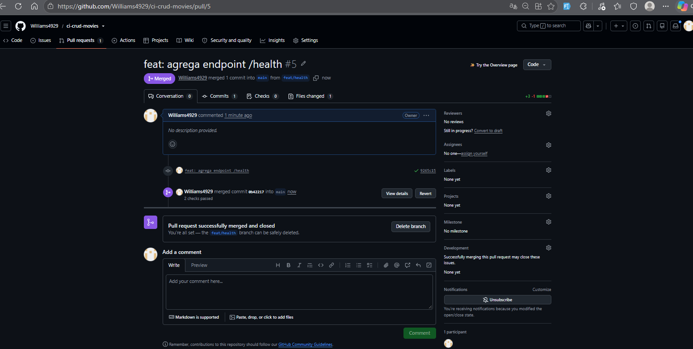

### 3.2 Dockerfile multi-stage

```dockerfile
# ---------- Etapa 1: dependencias de produccion ----------
FROM node:20-alpine AS deps
WORKDIR /app
COPY package*.json ./
RUN npm ci --omit=dev

# ---------- Etapa 2: imagen final ----------
FROM node:20-alpine
ENV NODE_ENV=production
WORKDIR /app
COPY --from=deps --chown=node:node /app/node_modules ./node_modules
COPY --chown=node:node package*.json ./
COPY --chown=node:node src ./src
USER node
EXPOSE 3000
CMD ["node", "src/server.js"]
```

**Decisiones técnicas:**
- La **etapa 1** instala solo las dependencias de producción (`npm ci --omit=dev`), dejando fuera Jest, ESLint y Supertest.
- La **imagen final** copia únicamente `node_modules` y la carpeta `src`. No incluye tests, cobertura, documentación ni el historial de Git.
- El contenedor se ejecuta con el usuario **`node`** (no root), lo que reduce el impacto de una posible vulnerabilidad.
- Se usa la variante **Alpine** por su tamaño reducido.

Archivo `.dockerignore`, para no enviar archivos innecesarios al contexto de build:

```text
node_modules
coverage
tests
docs
.git
.github
.env
*.pem
Dockerfile
.dockerignore
*.md
```

**Resultado:** imagen de **49.1 MB** de contenido (199 MB descomprimida en disco). Se probó localmente en el puerto 3001, porque el 3000 estaba ocupado en el equipo de desarrollo:

```powershell
docker build -t ci-crud-movies:local .
docker run -d -p 3001:3000 --name app-local ci-crud-movies:local
curl.exe http://localhost:3001/health
```

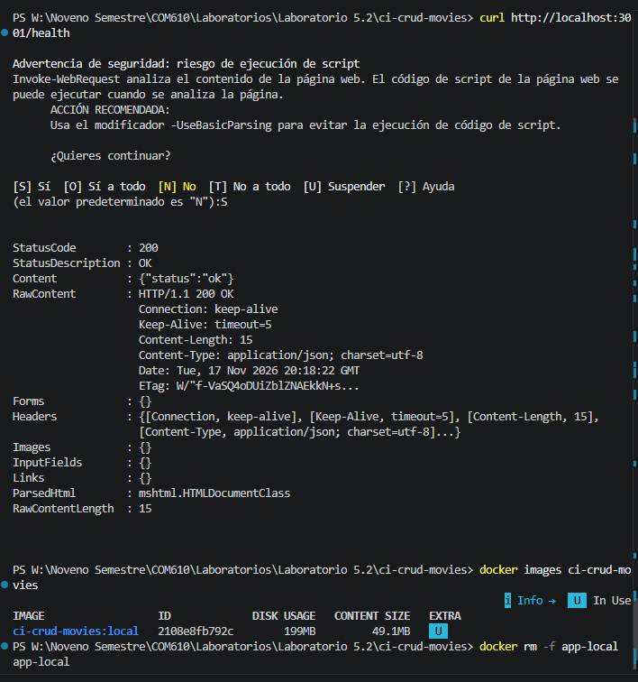

> La captura corresponde a la primera prueba: el contenedor respondía HTTP 200, pero aún sin el campo `version`. Así se detectó la ruta `/health` duplicada descrita en la sección 3.1.

## 4. Gestión de secretos y entornos

### 4.1 Secretos y variables del repositorio

Compartidos por todos los jobs (Settings → Secrets and variables → Actions):

| Tipo | Nombre | Uso |
|---|---|---|
| Secret | `DOCKER_USERNAME` | Usuario de Docker Hub |
| Secret | `DOCKER_PASSWORD` | **Personal Access Token** de Docker Hub (Read & Write), no la contraseña de la cuenta |
| Variable | `IMAGE_NAME` | `will4929/ci-crud-movies` |

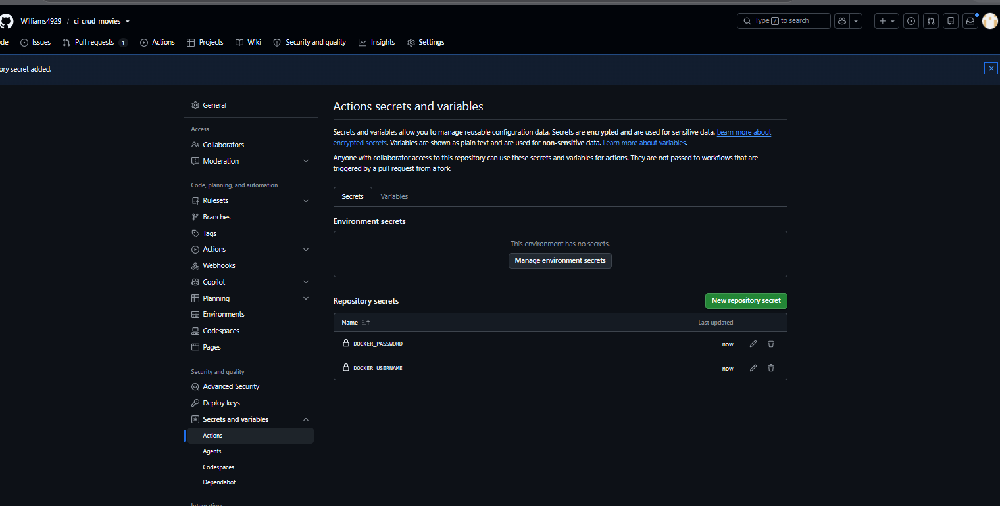
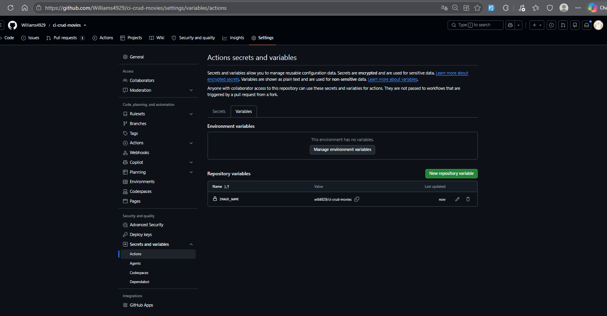

### 4.2 Servidores EC2

Se crearon dos instancias independientes, cada una con su **propio par de llaves SSH** (`staging-key.pem` y `production-key.pem`), y se instaló Docker en ambas:

```bash
curl -fsSL https://get.docker.com | sudo sh
sudo usermod -aG docker ubuntu
```

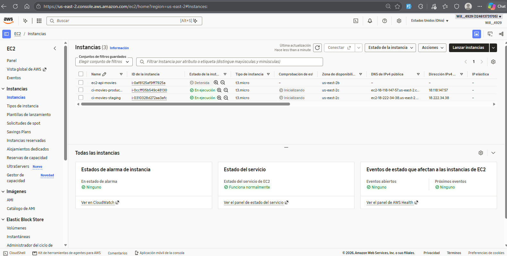
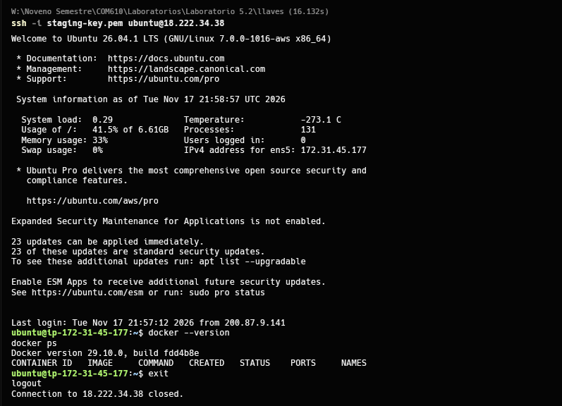
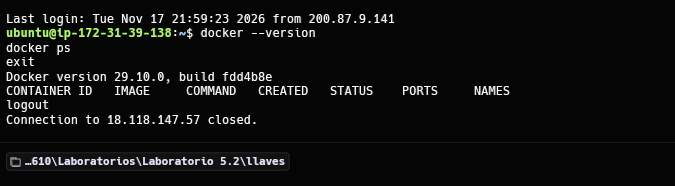

> **Problema encontrado:** al conectarse por SSH desde Windows, OpenSSH rechazó las llaves con `UNPROTECTED PRIVATE KEY FILE`, porque el grupo *Usuarios autentificados* tenía permisos de lectura sobre el archivo `.pem`. Se resolvió dejando acceso solo al usuario actual:
> ```powershell
> icacls staging-key.pem /inheritance:r
> icacls staging-key.pem /grant:r "$($env:USERNAME):(R)"
> icacls staging-key.pem /remove "*S-1-5-11" "*S-1-5-32-545" "*S-1-1-0"
> ```

### 4.3 GitHub Environments

Se crearon dos entornos (Settings → Environments), cada uno con **sus propios secretos**:

| | `staging` | `production` |
|---|---|---|
| `SSH_HOST` (secret) | 18.222.34.38 | 18.118.147.57 |
| `SSH_USER` (secret) | ubuntu | ubuntu |
| `SSH_PRIVATE_KEY` (secret) | contenido de `staging-key.pem` | contenido de `production-key.pem` |
| `PUBLIC_HOST` (variable) | 18.222.34.38 | 18.118.147.57 |
| Regla de protección | Ninguna (despliegue automático) | **Required reviewers: Williams4929** |

Como cada job de despliegue declara `environment: staging` o `environment: production`, el mismo nombre de secreto (`SSH_HOST`) toma un valor distinto según el entorno. En **production**, el pipeline se detiene hasta que un revisor aprueba el despliegue.

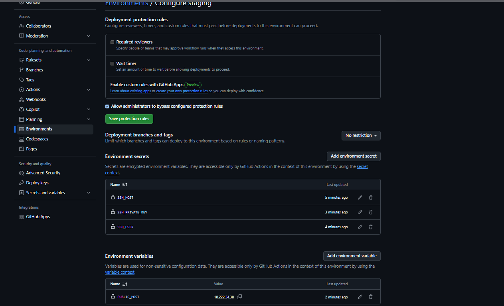
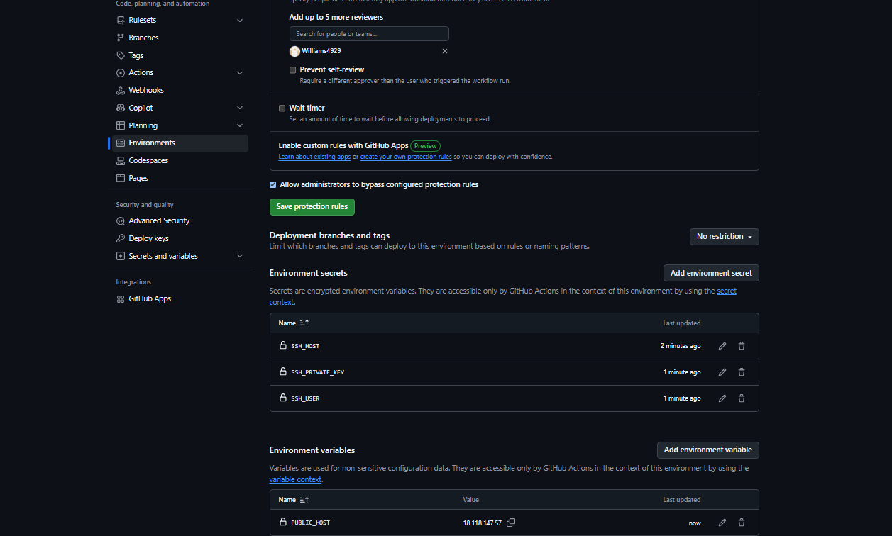

## 5. Workflow de CD (`.github/workflows/cd.yml`)

**Disparadores:** `push` a `main` (es decir, cada merge de un PR) y `workflow_dispatch` (ejecución manual).

| # | Job | Depende de | Qué hace |
|---|---|---|---|
| 1 | `build-and-push` | – | Checkout, login en Docker Hub y build + push de la imagen con dos tags: `:<sha del commit>` y `:latest` |
| 2 | `scan` | build-and-push | Escanea la imagen `:<sha>` con Trivy (SO y librerías, CRITICAL y HIGH, ignorando las que no tienen parche) |
| 3 | `deploy-staging` | build-and-push, scan | Despliegue por SSH en staging con health check |
| 4 | `deploy-production` | deploy-staging | Igual que staging, pero en producción y solo después de la aprobación manual |

**Script de despliegue (igual en ambos entornos):**
1. `docker pull` de la imagen etiquetada con el SHA del commit.
2. Levanta un contenedor de validación `mi-app-new` en el puerto **3001**.
3. Espera 8 segundos y ejecuta `curl -sf http://localhost:3001/health`.
4. **Si responde:** elimina el contenedor de validación y el anterior, y levanta `mi-app` en el puerto **80** con `--restart unless-stopped`.
5. **Si falla:** muestra los logs, elimina el contenedor de validación y termina con `exit 1`. El contenedor anterior **no se toca**.
6. `docker image prune -f` para limpiar imágenes huérfanas.

**Decisiones técnicas del workflow:**
- **Despliegue por SHA y no por `latest`:** cada servidor ejecuta una imagen exacta e identificable (`:1a238f1…`). Esto da trazabilidad (qué commit corre en cada entorno) y permite el rollback.
- **Health check antes de exponer la nueva versión:** evita dejar la API caída si la nueva imagen no arranca.
- **Staging antes que production:** la versión se valida en un entorno igual al real antes de llegar a los usuarios.
- **Aprobación manual en production:** ningún cambio llega a producción sin una revisión humana.
- **El escaneo va en un job separado y sin secretos:** la acción de Trivy no tiene acceso a las credenciales de Docker Hub ni a las llaves SSH.
- **La acción de Trivy está fijada a un commit (`@ed142fd…`, v0.36.0) y no a `@master`:** en marzo de 2026 el repositorio `aquasecurity/trivy-action` sufrió un ataque de cadena de suministro en el que se reescribieron sus tags de versión para distribuir un programa que robaba credenciales. Fijar la acción a un commit concreto evita ejecutar código modificado sin aviso.

## 6. Ejecución del pipeline

### 6.1 Primer despliegue – versión 1.0.0 (Run #1)

El PR #6 (`feat/lab-5.2-cd`) incorporó el Dockerfile, el `.dockerignore` y el workflow. Pasó los 2 checks del CI y, al hacer merge (commit `1a238f1`), se disparó el CD.

`build-and-push`, `scan` y `deploy-staging` terminaron correctamente, y el job de producción quedó **esperando revisión**:

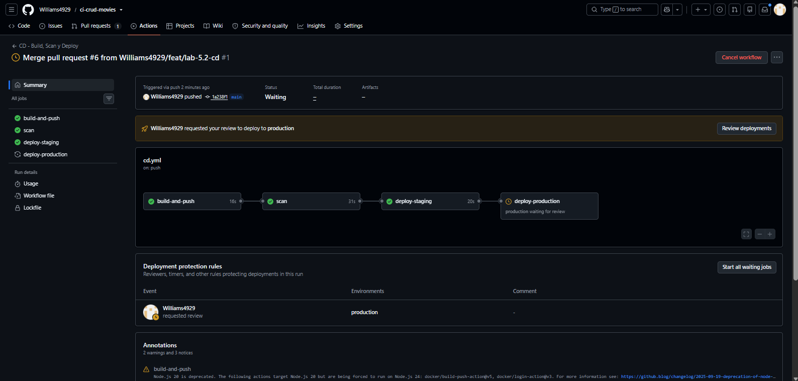

Tras validar staging, se aprobó el despliegue con el comentario *"staging validado correctamente"*. El run terminó en **Success en 3 min 33 s**:

| Job | Duración |
|---|---|
| build-and-push | 16 s |
| scan | 31 s |
| deploy-staging | 20 s |
| deploy-production | 18 s |

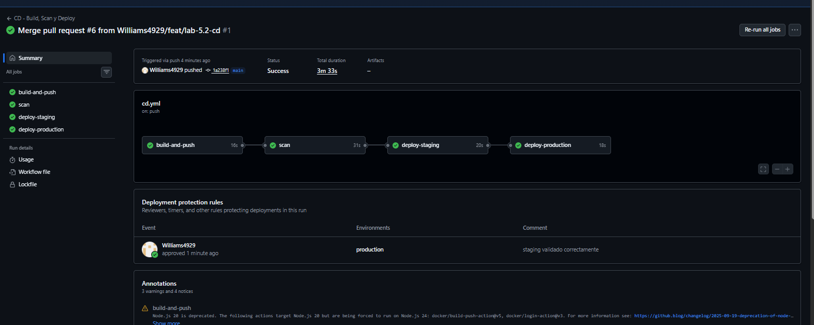
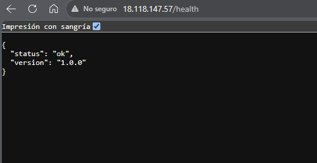

Cada ejecución publicó en Docker Hub la imagen con dos tags: el SHA completo del commit (por ejemplo `1a238f1cf2215fd68abfd6f583941dec3e116ed5`) y `latest`. Esto se aprovecha más adelante para el rollback (sección 8).

### 6.2 Cambio de versión – 2.0.0 (Run #2)

Se cambió la respuesta de `/health` a `version: '2.0.0'` en la rama `feat/version-2` y se integró con un PR. Al hacer merge, el pipeline construyó, escaneó y desplegó la nueva versión automáticamente en ambos entornos (con aprobación para producción), **sin ningún paso manual en los servidores**.

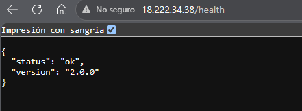
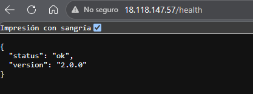

### 6.3 Simulación de fallo del health check (Run #3)

Para comprobar la protección del despliegue, en la rama `test/healthcheck-fallido` se cambió el puerto del servidor a uno incorrecto:

```js
const PORT = 4000; // ERROR INTENCIONAL
```

Los tests del CI siguieron pasando, porque `server.js` está excluido de la cobertura y los tests usan directamente `app`, así que el PR #8 se pudo fusionar (commit `6de11e1`). En el CD:

| Job | Resultado |
|---|---|
| build-and-push | ✅ 26 s |
| scan | ✅ 11 s |
| deploy-staging | ❌ 14 s – `Process completed with exit code 1` |
| deploy-production | ⊘ No se ejecutó |

El contenedor de validación no respondió en `/health`, el script mostró **"Health check FALLIDO. Se mantiene la version anterior."** y canceló el despliegue. **Staging siguió respondiendo con la versión 2.0.0** y producción nunca se tocó.

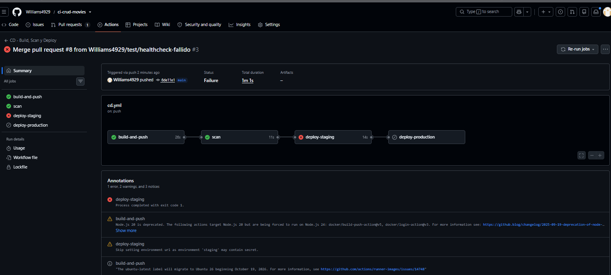

El error se corrigió en la rama `fix/puerto` (PR #9, commit `3cc673f`) y el pipeline volvió a completarse en **2 min 18 s** (build 21 s, scan 12 s, staging 14 s, production 14 s).

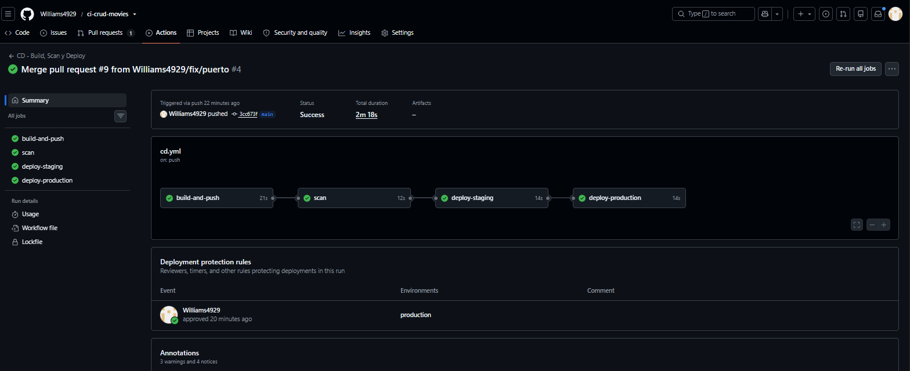

## 7. Escaneo de vulnerabilidades

Resultado de Trivy sobre la imagen `will4929/ci-crud-movies:1a238f1…` (filtro: CRITICAL y HIGH, solo vulnerabilidades con parche disponible):

| Sección | CRITICAL | HIGH | Total |
|---|---|---|---|
| Node.js (node-pkg) | 1 | 21 | **22** |

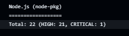

**Análisis:** la aplicación solo tiene una dependencia de producción (`express`), así que la mayoría de estos paquetes no pertenecen al código del proyecto. Vienen de los módulos de Node.js que trae la **imagen base** `node:20-alpine` (como npm y sus dependencias internas), que la aplicación no necesita para ejecutarse. El escaneo se configuró con `exit-code: '0'` para que **informe sin bloquear** el pipeline, que es lo adecuado en un entorno académico.

**Mejoras propuestas:**
1. Actualizar la imagen base a `node:24-alpine`, porque Node.js 20 ya llegó al fin de su soporte.
2. Eliminar npm de la imagen final (`rm -rf /usr/local/lib/node_modules/npm /usr/local/bin/npm /usr/local/bin/npx`), ya que solo hace falta `node` en tiempo de ejecución.
3. En un proyecto real, cambiar a `exit-code: '1'` para **bloquear** el despliegue si aparecen vulnerabilidades CRITICAL.

## 8. Rollback a una versión anterior

Como cada imagen queda etiquetada con el **SHA completo del commit**, todas las versiones siguen disponibles en Docker Hub y se puede volver a cualquiera sin recompilar.

### 8.1 Rollback manual (realizado en producción)

Producción estaba en la versión **2.0.0** y se volvió a la **1.0.0** (commit `1a238f1`).

1. Obtener el SHA completo del commit:
   ```powershell
   git rev-parse 1a238f1
   # 1a238f1cf2215fd68abfd6f583941dec3e116ed5
   ```
2. En el servidor de producción:
   ```bash
   SHA=1a238f1cf2215fd68abfd6f583941dec3e116ed5
   docker pull will4929/ci-crud-movies:$SHA
   docker rm -f mi-app
   docker run -d --name mi-app --restart unless-stopped \
     --env-file ~/mi-app/.env -p 80:3000 will4929/ci-crud-movies:$SHA
   docker ps
   curl -s http://localhost/health
   # {"status":"ok","version":"1.0.0"}
   ```

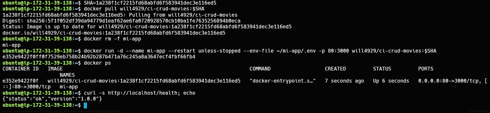

> **Lección aprendida:** el tag de la imagen es el SHA del commit de Git. El valor `sha256:5f1f…` que muestra Docker Hub es el **digest** de la imagen y no se puede usar como tag (`imagen:sha256:…` da *invalid reference format*). Si se quiere usar el digest, la sintaxis es con arroba: `imagen@sha256:…`.

### 8.2 Rollback desde GitHub Actions

También se puede volver a una versión anterior sin entrar al servidor: en la pestaña **Actions** se abre el run de la versión que funcionaba y se usa **Re-run all jobs**. Como el deploy usa el `github.sha` de ese run, se despliega la imagen de ese commit (con la aprobación de producción, como siempre). Con este mismo método, volviendo a ejecutar el Run #4, se puede devolver producción a la versión 2.0.0 después del rollback manual.

## 9. Problemas encontrados y soluciones

| Problema | Causa | Solución |
|---|---|---|
| `git push` rechazado a `main` (GH006) | Protección de rama del Lab 5.1 | Trabajar con ramas y Pull Requests |
| `/health` sin el campo `version` | Ruta duplicada; Express usa la primera | Eliminar el duplicado |
| `UNPROTECTED PRIVATE KEY FILE` | Permisos de Windows sobre el `.pem` | `icacls` para dejar acceso solo al usuario actual |
| Nombres de secretos y variables mal ingresados | Se escribió el valor en el campo *Name* | Recrear con `DOCKER_USERNAME`, `DOCKER_PASSWORD` e `IMAGE_NAME` |
| `invalid reference format` en el rollback | Se usó el digest como tag | Usar el SHA del commit como tag |
| Advertencia "Node.js 20 is deprecated" | `docker/login-action@v3` y `build-push-action@v5` usan Node 20 | No afecta; se puede actualizar a `@v4` y `@v7` |

## 10. Reflexión

Usar contenedores cambia por completo la forma de entregar software. La imagen Docker que se construye una sola vez en GitHub Actions es **exactamente la misma** que corre en staging y en producción, así que desaparece el clásico "en mi máquina funciona": el entorno viaja junto con la aplicación. Además, la imagen es liviana (49 MB), se ejecuta sin privilegios de root y se puede levantar en cualquier servidor que tenga Docker, sin instalar Node.js ni dependencias a mano.

El despliegue continuo convierte cada merge en una entrega real en pocos minutos y elimina pasos manuales (conectarse por SSH, copiar archivos, reiniciar procesos), que es justo donde se cometen más errores. Durante el laboratorio se comprobó que la automatización no significa perder el control. El **health check** impidió publicar una versión rota (Run #3) mientras la anterior seguía atendiendo. El entorno de **staging** permitió validar cada versión antes que los usuarios. La **aprobación manual** dejó la decisión final de llegar a producción en manos de una persona. Y gracias al **etiquetado por SHA**, volver a una versión anterior tomó segundos.

También quedó claro que un pipeline es parte de la superficie de ataque: maneja credenciales de Docker Hub y llaves SSH de los servidores. Por eso se usaron tokens en lugar de contraseñas, secretos separados por entorno, acciones de terceros fijadas a un commit y un escaneo de vulnerabilidades en cada versión. Como limitación, esta API guarda los datos en memoria, así que se pierden en cada despliegue. En un proyecto real habría que usar una base de datos externa (por ejemplo, Amazon RDS) con sus credenciales en los secretos de cada entorno.
