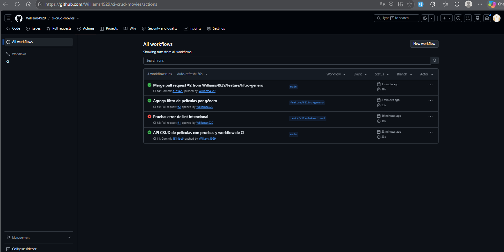
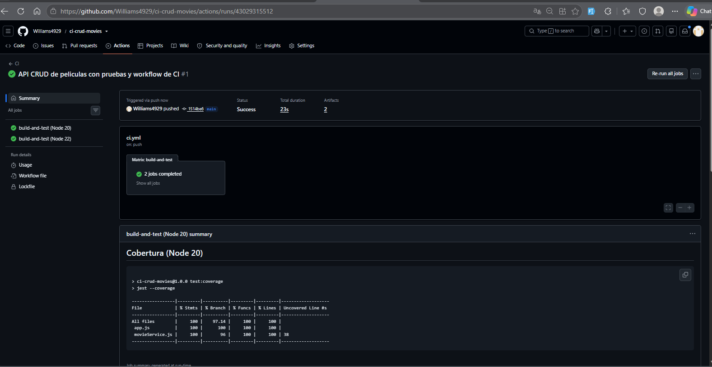
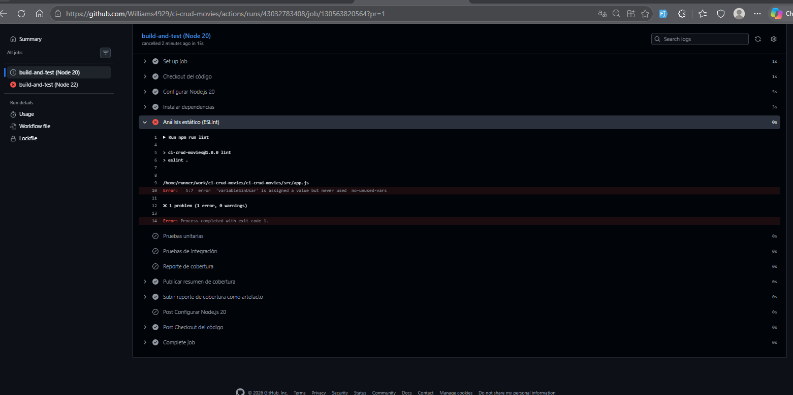
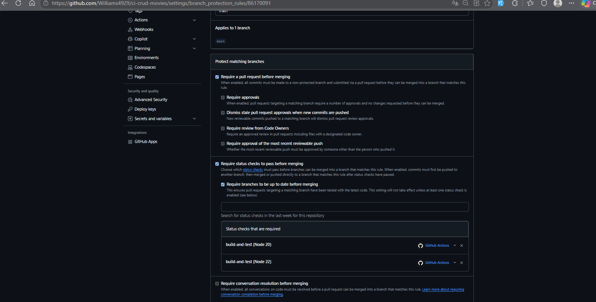
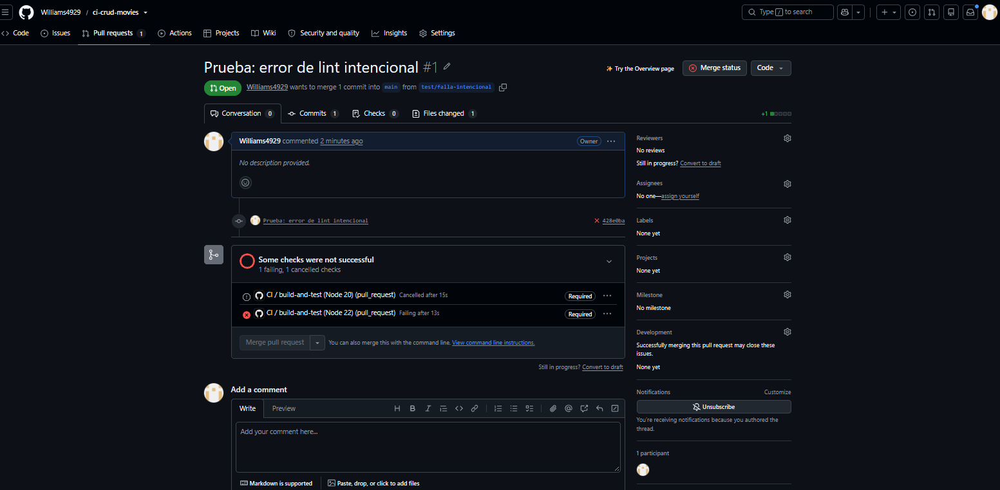
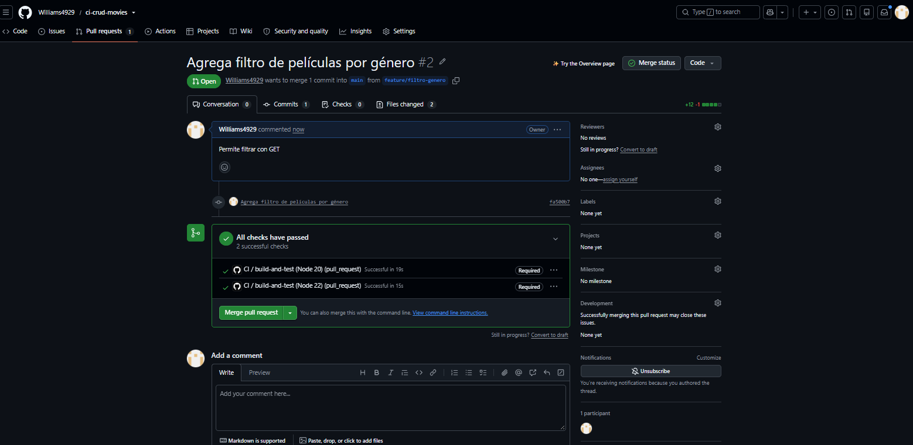

# Informe – Lab 5.1: Creación de un Workflow de GitHub Actions para CI

| | |
|---|---|
| **Estudiante** | Miranda Pereyra Williams
| **Materia** | COM610 – Trabajo en la Nube |
| **Repositorio** | https://github.com/Williams4929/ci-crud-movies |
| **Fecha** | 11/11/2026 |

---

## 1. Descripción del proyecto

API REST desarrollada en **Node.js + Express** para gestionar la entidad **Movie** (película), con operaciones CRUD completas:

| Método | Ruta | Descripción |
|---|---|---|
| GET | `/health` | Verifica que el servicio esté activo |
| GET | `/movies` | Lista las películas (admite el filtro `?genre=`) |
| GET | `/movies/:id` | Obtiene una película por su id |
| POST | `/movies` | Crea una película (valida `title` y `year`) |
| PUT | `/movies/:id` | Actualiza una película |
| DELETE | `/movies/:id` | Elimina una película |

Los datos se almacenan en memoria para que las pruebas sean rápidas y no dependan de una base de datos externa.

### Estructura del proyecto

```
ci-crud-movies/
├── .github/workflows/ci.yml       # Workflow de CI
├── docs/img/                      # Capturas del informe
├── src/
│   ├── app.js                     # Rutas HTTP (Express)
│   ├── movieService.js            # Lógica de negocio y validaciones
│   └── server.js                  # Arranque del servidor
├── tests/
│   ├── unit/movieService.test.js        # Pruebas unitarias
│   └── integration/movies.api.test.js   # Pruebas de integración
├── eslint.config.mjs
├── package.json
├── README.md
└── INFORME.md
```

### Pruebas

- **Unitarias** (`tests/unit`): validan la lógica de `movieService` (validaciones, creación con id incremental, actualización y eliminación, incluidos los casos en que el registro no existe).
- **De integración** (`tests/integration`): con **Supertest** prueban los endpoints HTTP completos, incluidas las respuestas de error 400 (datos inválidos) y 404 (recurso no encontrado), y el filtro por género.

---

## 2. Descripción del pipeline de CI

El workflow está en `.github/workflows/ci.yml`. Se ejecuta en cada `push` y `pull_request` hacia la rama `main`, sobre `ubuntu-latest`, con una **matriz de Node.js 20 y 22**, es decir, dos jobs en paralelo.

| Paso | Herramienta | Propósito |
|---|---|---|
| Checkout del código | `actions/checkout@v6` | Descarga el código del repositorio |
| Configurar Node.js | `actions/setup-node@v6` | Instala la versión de Node de la matriz y cachea las dependencias de npm |
| Instalar dependencias | `npm ci` | Instalación limpia y reproducible a partir de `package-lock.json` |
| Build | — | No aplica: JavaScript no requiere compilación |
| Análisis estático | ESLint | Detecta errores y malas prácticas en el código |
| Pruebas unitarias | Jest | Validan la lógica de negocio |
| Pruebas de integración | Jest + Supertest | Validan los endpoints de la API |
| Reporte de cobertura | `jest --coverage` | Mide la cobertura con un umbral mínimo (80 % de líneas y 70 % de ramas) |
| Resumen y artefacto | `$GITHUB_STEP_SUMMARY` y `actions/upload-artifact` | Publica la tabla de cobertura en el Summary de la ejecución y sube el reporte HTML como artefacto descargable |

**Resultado de cobertura:** 100 % de sentencias, funciones y líneas, y 97,14 % de ramas.

### Protección de la rama `main`

Se configuró una regla de protección (*Settings → Branches → Branch protection rule*) con estas condiciones:

- Se exige un **Pull Request** para integrar cambios en `main`.
- Se exige que los status checks `build-and-test (Node 20)` y `build-and-test (Node 22)` **pasen antes del merge**.
- Se exige que la rama esté actualizada con `main` antes de integrarla.
- No se permite omitir (*bypass*) estas reglas, ni siquiera al administrador.

---

## 3. Evidencias

### 3.1 Historial de ejecuciones

Se observan cuatro ejecuciones que muestran el ciclo completo:

1. **#1:** push inicial a `main` ✅
2. **#2:** Pull Request con un error de lint intencional ❌
3. **#3:** Pull Request con la nueva funcionalidad (filtro por género) ✅
4. **#4:** merge del Pull Request a `main` ✅



### 3.2 Ejecución exitosa con reporte de cobertura

Los dos jobs de la matriz (Node 20 y Node 22) finalizaron correctamente, y la tabla de cobertura se publica automáticamente en el Summary de la ejecución.



### 3.3 Ejecución fallida (forzada intencionalmente)

Se agregó una variable sin usar (`variableSinUsar`) en `src/app.js`. ESLint detectó el error `no-unused-vars` y el pipeline se detuvo en el paso de análisis estático, sin llegar a ejecutar las pruebas.

El job de Node 20 aparece como *cancelled* porque la estrategia de matriz usa `fail-fast` por defecto: cuando un job falla, GitHub Actions cancela los demás para no gastar recursos.



### 3.4 Configuración de protección de rama



### 3.5 Pull Request bloqueado por CI fallido

Con los checks requeridos en estado fallido, GitHub deshabilita el botón **Merge pull request**. Este Pull Request se cerró sin integrarse.



### 3.6 Pull Request con los checks aprobados

En el Pull Request con la nueva funcionalidad, los dos checks requeridos pasaron, GitHub habilitó el merge y el cambio se integró a `main`.



---

## 4. Conclusiones y reflexión

- **Automatización de la calidad:** la integración continua ejecuta lint, pruebas y cobertura en cada cambio, sin depender de que el desarrollador recuerde hacerlo manualmente.
- **Detección temprana de errores:** el pipeline detectó un error real (una variable sin usar) antes de que llegara a la rama principal. Junto con la protección de rama, GitHub **impidió el merge**, de modo que `main` siempre contiene código que pasa todas las validaciones.
- **Compatibilidad entre versiones:** la matriz confirma que la aplicación funciona en Node.js 20 y 22 sin esfuerzo adicional, y ambas versiones corren en paralelo, en unos 20 segundos.
- **Cobertura como criterio de calidad:** el umbral mínimo de cobertura impide que se agregue código sin sus pruebas correspondientes.
- **Flujo de trabajo con ramas y Pull Requests:** aunque el trabajo fue individual, cada cambio quedó registrado junto con su validación automática. En un equipo de desarrollo este flujo es indispensable para que un integrante no rompa el trabajo de los demás, y se integra naturalmente con metodologías ágiles como Scrum, donde se entregan incrementos funcionales y verificados en cada iteración.

En conclusión, GitHub Actions permitió implementar un pipeline de CI completo con poca configuración. El valor principal de la CI es la **confianza**: cada cambio que llega a `main` ya fue verificado automáticamente.
